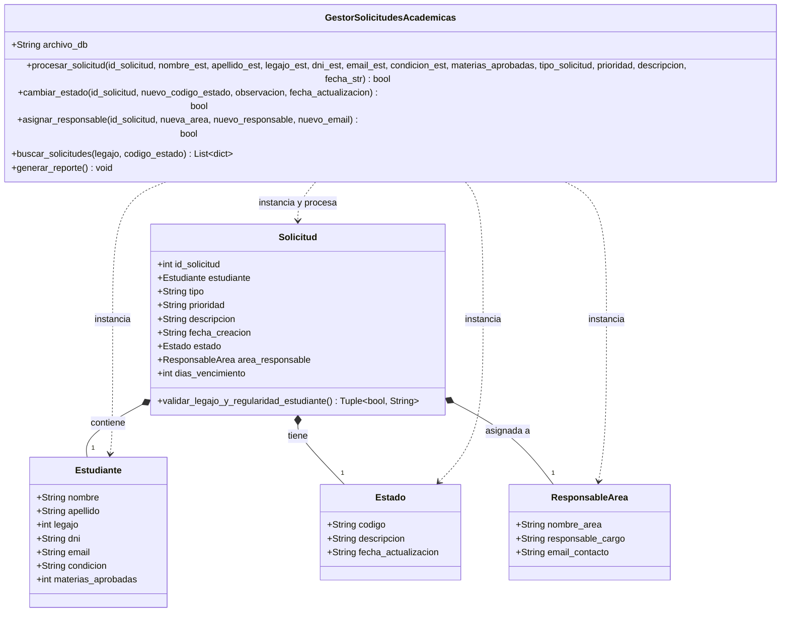

# Diagrama de Clases UML - Sistema Base (`estado-inicial`)

Este diagrama representa la estructura inicial del **Sistema de Gestión de Solicitudes Académicas** antes del proceso de refactoring.

## Descripción de Entidades Iniciales
- **`Estudiante`**: Datos personales y condición académica del alumno solicitante (`REG`, `LIBRE`, `EGR`).
- **`Estado`**: Estado actual del trámite (`PEND`, `REV`, `APR`, `RECH`), observación y fecha de último cambio.
- **`ResponsableArea`**: Sector institucional y autoridad asignada para la resolución del expediente.
- **`Solicitud`**: Entidad principal que agrupa al estudiante, el estado, el área responsable y los plazos del trámite.
- **`GestorSolicitudesAcademicas`**: Clase encargada de procesar las operaciones del sistema y gestionar la persistencia en `solicitudes_db.json`.